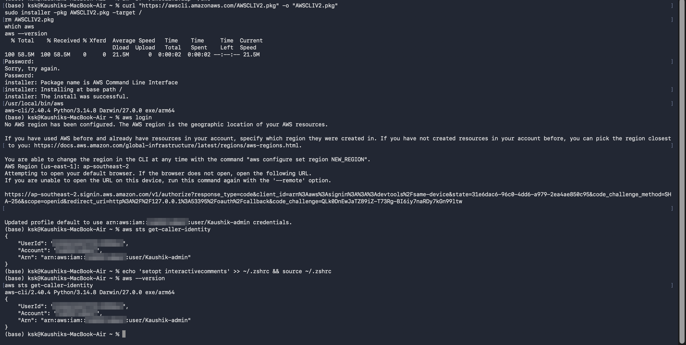
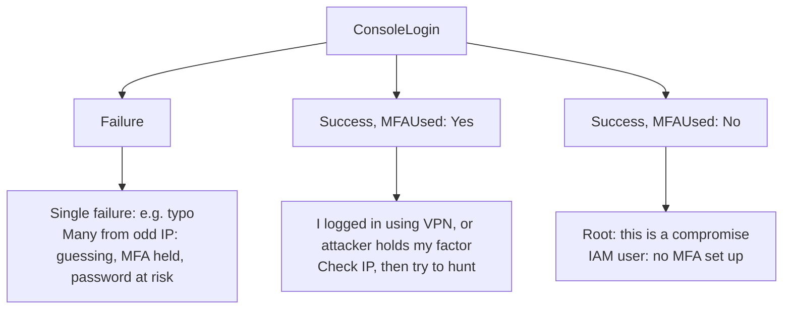

# 01 – AWS Account Baseline

**Date:** 17 Nov 2026 · **Region:** ap-southeast-2 (Sydney) · **Tools:** AWS console, AWS CLI 2.40.4
**Phase 1, Week 1** of my [cloud security learning path](../README.md)

## Golden rule

Make the most powerful account the most difficult to reach. In AWS, that is the **root account**.

## Threat model: what stolen root gives an attacker

The root user is the email I signed up with. As root, I (or an attacker) can:

- create users
- turn off logging
- close the account
- run GPU instances (e.g. for crypto-mining)

Normally, IAM policies limit what an AWS identity can do. The root user is not checked against IAM policies, so it has every privilege, and if an attacker steals root, nothing inside the account can stop them. The real defence is stopping root from being stolen in the first place.

If I suspect root is stolen: move root to a new email address that has never been used anywhere, change the root password, and check every MFA device registered on root.

## Lesson from the Code Spaces breach (2014)

1. The most powerful login must be the best protected.
2. A backup in the same account as production is not a real backup.

An attacker got into Code Spaces' AWS control panel and demanded a ransom; when the company fought back, the attacker deleted its instances, data and backups, and the company shut down.

## Hardening controls

| # | Step | Attacker's view | What I do |
| --- | --- | --- | --- |
| 1 | Choose the account email | Root's password resets by email, so owning the inbox is half of root. A uni email dies after graduation. | Personal email with its own MFA (e.g. you+aws-lab@gmail.com). Free plan, Basic support. |
| 2 | Lock down root | Phishing pages capture passwords and TOTP codes and replay them. A passkey only works on the real AWS domain. | Long random password in a password manager. Passkey MFA plus a second backup device. |
| 3 | No root access keys | Bots scan GitHub for leaked keys within minutes. A root key has no MFA, never expires, and can do anything. | Check Security credentials shows no access keys. Never create one. |
| 4 | Security contact | AWS emails abuse warnings. An unread inbox gives the attacker more time. | Account → Alternate contacts → Security: an email I check. |
| 5 | Billing tripwire | Crypto-mining (ATT&CK T1496). On the Free plan it burns credits, which closes the account. | Activate IAM access to billing. Budgets at $1 and $5, alerts at 80% actual and 100% forecast. **Exclude credits.** |
| 6 | Everyday admin user | Using root daily makes root the target of every phish. An admin user cannot close the account or change the root email. | Password policy (14+ chars). Group Admins with AdministratorAccess. User kaushik-admin with passkey MFA. Sign out of root. |
| 7 | CLI without access keys | After a laptop compromise, the first file read is ~/.aws/credentials. Long-lived keys keep working. | Install CLI 2.32+, run aws login, sign in as kaushik-admin. |
| 8 | Verify identity | Root used by accident is a silent risk. | aws sts get-caller-identity: the ARN must end in :user/kaushik-admin, not :root. |
| 9 | Look at my own logins | Defenders find attackers in these same logs. | CloudTrail → Event history → ConsoleLogin. Check MFAUsed and the result. |

### Evidence (collected with the CLI, account ID removed)

```console
$ aws iam get-account-summary --output json | jq '.SummaryMap | {AccountMFAEnabled, AccountAccessKeysPresent}'
{
  "AccountMFAEnabled": 1,
  "AccountAccessKeysPresent": 0
}

$ aws iam get-group --group-name Admins --output json | jq '[.Users[].UserName]'
[
  "Kaushik-admin"
]

$ aws iam list-attached-group-policies --group-name Admins --output json | jq '[.AttachedPolicies[].PolicyName]'
[
  "AdministratorAccess"
]

$ aws iam list-mfa-devices --user-name Kaushik-admin --output json | jq '.MFADevices'
[
  {
    "UserName": "Kaushik-admin",
    "SerialNumber": "arn:aws:iam::123456789012:u2f/user/Kaushik-admin/MAC-XXXXXXXXXXXXXXXXXXXXXXXXXX",
    "EnableDate": "2026-11-17T14:07:44+00:00"
  }
]
```

```console
$ aws budgets describe-budgets --account-id "$(aws sts get-caller-identity --query Account --output text)" --output json \
  | jq '[.Budgets[] | {name: .BudgetName, limit: .BudgetLimit.Amount, includesCredits: .CostTypes.IncludeCredit}]'
```

Verified: both budgets ($1 and $5) return `includesCredits: false`, so credits cannot hide real usage.

### Findings from auditing my own baseline

| # | Finding | Evidence | Fix |
| --- | --- | --- | --- |
| 1 | The Admins group had two unneeded policies: AdministratorAccess-AWSElasticBeanstalk and AdministratorAccess-Amplify (ticked by mistake when searching for AdministratorAccess). | `list-attached-group-policies` showed 3 policies. | Detached both. Now only AdministratorAccess. |
| 2 | Kaushik-admin was created without MFA. A console login at 07:37 UTC succeeded with `MFAUsed: No`. | CloudTrail ConsoleLogin (ap-southeast-2): IAMUser, Success, MFAUsed No. | Passkey added at 14:07 UTC. Verified: the next login shows MFAUsed: Yes. |
| 3 | Root sign-ins were not in my region's Event history. CloudTrail Event history is regional; root sign-ins appeared in us-east-1. | `lookup-events --region us-east-1` showed 2 root failures (07:02, 07:06 UTC) and 1 success (07:20 UTC), all MFAUsed: Yes. | Checked errorMessage and sourceIPAddress: the failures were my own attempts. Lesson: always check us-east-1 for sign-in events. |

## CLI setup (no access keys)

- AWS CLI version: **2.40.4**
- Region: **ap-southeast-2**
- Signed in with `aws login` as kaushik-admin



```console
$ aws sts get-caller-identity
{
    "UserId": "AIDAXXXXXXXXXXXXXXXXX",
    "Account": "123456789012",
    "Arn": "arn:aws:iam::123456789012:user/Kaushik-admin"
}
```

| | Access key | `aws login` |
|---|---|---|
| **How long it works** | Never expires until you delete it | 15 minutes, refreshed for up to 12 hours |
| **MFA** | None when it's used, so a stolen key works immediately | Your passkey is checked at sign-in, so getting a fresh session requires MFA |
| **How it typically leaks** | Committed to git, pasted into chats, left in `.env` files, copied into CI jobs | Has to be stolen from your laptop, and the stolen credentials stop working after a few hours |

| Prefix | What it is |
|---|---|
| `AIDA` | IAM user |
| `AROA` | IAM role |
| `AKIA` | Long-lived access key (a danger sign if you find one leaked) |
| `ASIA` | Temporary credentials, like the ones `aws login` gives you |

## Detection: reading ConsoleLogin events

Then I read the ConsoleLogin events in CloudTrail, specifically the MFAUsed field.



| Login result | `MFAUsed` | What it most likely means |
|---|---|---|
| Success | Yes | It was you, or the attacker has your second factor. |
| Failure | No | Someone tried a password and got stopped. **Defences worked.** One failure is probably you mistyping. Many failures from a strange IP mean someone is guessing or trying leaked passwords. |
| **Success** | **No** | **The worst case.** A password alone was enough. |

Other important fields: `userIdentity.type`, `sourceIPAddress`, `userAgent`, `additionalEventData.MFAUsed`

AWS logs `MFAUsed: No` for SSO or federated logins because the multi-factor authentication decision happens at a third-party or external Identity Provider (IdP) rather than natively in AWS IAM. Detection rules must allow for that.

## What I got wrong

- I assumed failed logins proved attackers had the password.
- I called groups "roles". They are different things.
- I read MFAUsed: Yes as a sign of safety when I saw a login from an unknown remote location.

- I thought access keys could do more than aws login. They can't: both carry the same permissions. The difference is that an access key needs no MFA when used, never expires, and works from any machine once leaked, while aws login credentials last 15 minutes and refresh only for up to 12 hours.

## References

- [AWS Free Tier docs](https://docs.aws.amazon.com/awsaccountbilling/latest/aboutv2/free-tier.md)
- [AWS IAM enforces MFA for root users](https://aws.amazon.com/about-aws/whats-new/2025/06/aws-iam-mfa-root-users-across-all-account-types)
- [IAM User Guide: MFA for the root user](https://docs.aws.amazon.com/IAM/latest/UserGuide/enable-mfa-for-root.html)
- [aws login announcement](https://aws.amazon.com/about-aws/whats-new/2025/11/console-credentials-aws-cli-sdk-authentication)
- [MITRE ATT&CK T1496 Resource Hijacking](https://attack.mitre.org/techniques/T1496/)
